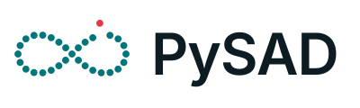
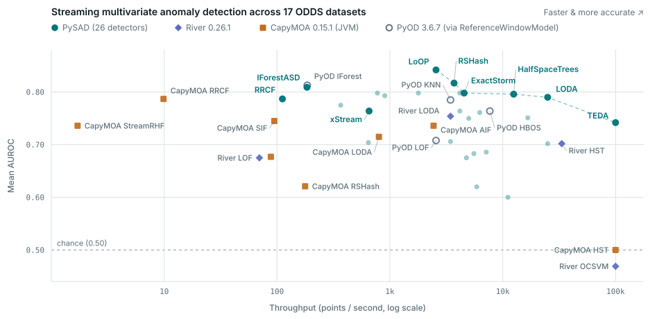

<p align="center"><b>English</b> · <a href="https://github.com/selimfirat/pysad/blob/master/README_zh.md">简体中文</a></p>

<p align="center">
  
</p>

<h3 align="center">One pass. Every outlier.</h3>

<p align="center">
  Streaming anomaly detection in Python for multivariate and univariate data streams.<br>
  PySAD scores and learns from each point as it arrives, with calibrated alerts, drift handling, and prequential evaluation—in pure Python, NumPy, SciPy, and scikit-learn.
</p>

<p align="center">
  <a href="https://pypi.org/project/pysad/"></a>
  <a href="https://anaconda.org/conda-forge/pysad"></a>
  <a href="https://pypi.org/project/pysad/"></a>
  <a href="https://github.com/selimfirat/pysad/blob/master/LICENSE"></a>
  <a href="https://doi.org/10.5281/zenodo.22983312"></a>
  <br>
  <a href="https://github.com/selimfirat/pysad/actions/workflows/coverage.yml"></a>
  <a href="https://results.pre-commit.ci/latest/github/selimfirat/pysad/master"></a>
  <a href="https://coveralls.io/github/selimfirat/pysad?branch=master"></a>
  <a href="https://pysad.readthedocs.io/en/stable/"></a>
  <a href="https://github.com/selimfirat/pysad/commits/master"></a>
  <br>
  <a href="https://pysad.readthedocs.io/en/stable/benchmark.html"></a>
  <a href="https://pysad.readthedocs.io/en/stable/detectors.html"></a>
  <a href="https://pysad.readthedocs.io/en/stable/detectors.html"></a>
</p>

<p align="center">
  <a href="https://pysad.readthedocs.io/en/stable/"><b>Documentation</b></a> ·
  <a href="https://pysad.readthedocs.io/en/stable/getting_started.html">Getting started</a> ·
  <a href="https://pysad.readthedocs.io/en/stable/guides/index.html">How-to guides</a> ·
  <a href="https://pysad.readthedocs.io/en/stable/benchmark.html">Benchmarks</a> ·
  <a href="https://pysad.readthedocs.io/en/stable/detectors.html">Detectors</a> ·
  <a href="https://pysad.readthedocs.io/en/stable/api.html">API</a> ·
  <a href="https://huggingface.co/spaces/selimfirat/pysad-playground">Interactive playground</a> ·
  <a href="https://selimfirat.github.io/pysad/lab/index.html?path=nyc_taxi_alerts.ipynb">Live demo</a> ·
  <a href="https://colab.research.google.com/github/selimfirat/pysad/blob/master/examples/quickstart.ipynb">Try it in Colab</a>
</p>

<p align="center">
  
</p>

<p align="center"><sub>A Robust Random Cut Forest scores three synthetic sensors one point at a time. Conformal calibration converts each score into the fraction of recent scores that it exceeds, and raises an alert at 0.995.</sub></p>

## Why PySAD

Batch detectors train on a fixed dataset. Streaming detectors update as points arrive, without waiting for a complete dataset. PySAD provides a common interface for scoring and learning from each point across both multivariate and univariate streams, including streams with concept drift. More than 60 publications on [Google Scholar](https://scholar.google.com/scholar?cites=3884618599898298487) cite it, and [30+ public repositories](https://github.com/selimfirat/pysad/network/dependents) on GitHub use it.

<table>
<tr>
<td width="50%" valign="top">

#### Built for streams

Every detector learns from and scores one point at a time with `fit_partial`, `score_partial` and `fit_score_partial`. Most detectors keep a bounded window, sketch, or set of trees rather than the full stream history.

</td>
<td width="50%" valign="top">

#### 54 detectors from published papers

Covers multivariate and univariate streams: robust/seasonal statistics (`MAD`, `SeasonalHybridESD`, `FluxEV`), forests and sketches (`LODA`, `HalfSpaceTrees`, `RobustRandomCutForest`, `RSHash`, `xStream`), subsequences (`DAMP`, `MatrixProfile`, `SAND`), graphs (`MIDAS`), and 10 drift monitors (`ADWINMeter`, `PageHinkleyMeter`, `DriftAdaptiveDetector`).

</td>
</tr>
<tr>
<td valign="top">

#### Calibrated alerts on one scale

`ConformalProbabilityCalibrator`, extreme-value `SPOTProbabilityCalibrator`, and `GaussianTailProbabilityCalibrator` normalize arbitrary raw scores onto a `[0, 1]` scale, paired with `ThresholdFilter` and `QuantileFilter` for binary alerts.

</td>
<td valign="top">

#### Prequential evaluation out of the box

`evaluate_stream`, `ArrayStreamer`, `PandasStreamer`, `PolarsStreamer`, and `CSVStreamer` replay streams without loading everything into memory, while `AUROCMetric`, `AUPRMetric`, and `WindowedMetric` update per point across 17 labeled ODDS datasets, 58 NAB series, and ULB credit-card fraud.

</td>
</tr>
<tr>
<td valign="top">

#### Composable pipelines & explanations

Chain preprocessing, projections, log parsing (`DrainLogParser`), detection, postprocessing, and calibration with `|`, combine detectors with `&`, and attribute anomalous features with `LODA.explain_partial()`.

</td>
<td valign="top">

#### Fits your existing ML stack

Wrap any [PyOD](https://github.com/yzhao062/pyod) detector on a sliding window (`ReferenceWindowModel`), drop PySAD detectors into [River](https://github.com/online-ml/river) (`PySADToRiverAdapter`) or scikit-learn (`PySADToScikitLearnAdapter`) pipelines, or score River forecasters (`PredictiveAnomalyDetector`).

</td>
</tr>
</table>

Batch outlier detectors such as [PyOD](https://github.com/yzhao062/pyod) can score new points after training, but need retraining to update what they have learned. General online learning frameworks such as [River](https://github.com/online-ml/river) and [CapyMOA](https://github.com/adaptive-machine-learning/CapyMOA) treat anomaly detection as one module among many (and CapyMOA requires Java). PySAD is built specifically for streaming anomaly detection: fast pure-NumPy/SciPy detectors, pipeline composition, score calibration, drift handling, and prequential evaluation in one lightweight package.

## Installation

```bash
pip install pysad
```

Or with Conda / Mamba / Pixi:

```bash
conda install -c conda-forge pysad
```

PySAD supports Python 3.11 to 3.14 on Linux, macOS and Windows. Every detector works after installation, with no optional extras or JVM required.

To install the latest development version from `master`:

```bash
pip install git+https://github.com/selimfirat/pysad.git
```

For an editable installation with development dependencies, follow the [contributing guide](https://pysad.readthedocs.io/en/latest/contributing.html).

## Quick start

[](https://huggingface.co/spaces/selimfirat/pysad-playground)
[](https://selimfirat.github.io/pysad/lab/index.html?path=nyc_taxi_alerts.ipynb)
[](https://colab.research.google.com/github/selimfirat/pysad/blob/master/examples/quickstart.ipynb)

Score a stream point by point, and measure the detector while it runs:

```python
import numpy as np
from pysad.evaluation import AUROCMetric
from pysad.models import LODA
from pysad.utils import ArrayStreamer

# A stream of 2,000 points with 4 features. Every 50th point is an anomaly.
rng = np.random.default_rng(42)
X = rng.normal(size=(2000, 4))
y = np.zeros(2000, dtype=int)
y[::50] = 1
X[y == 1, :2] += 3  # the code shifts the anomalies in two of the four features

model = LODA(random_state=0)
metric = AUROCMetric()

for x, label in ArrayStreamer().iter(X, y):
    score = model.fit_score_partial(x)  # score x, then learn from it
    metric.update(label, score)

print(f"AUROC: {metric.get():.3f}")  # prints AUROC: 0.960
```

### Turn scores into alerts

A higher score means a more anomalous point, but raw scores have no fixed scale. Chain a detector with `ConformalProbabilityCalibrator` (or `SPOTProbabilityCalibrator` for extreme-value thresholding) using `|` to convert scores into ranks in `[0, 1]`, and alert when the calibrated value nears `1`:

```python
from pysad.transform.probability_calibration import ConformalProbabilityCalibrator

pipeline = LODA(random_state=0) | ConformalProbabilityCalibrator(window_size=500)

alerts = []
for t, x in enumerate(ArrayStreamer().iter(X)):
    calibrated = pipeline.fit_score_partial(x)
    if t >= 200 and calibrated >= 0.99:  # skip a short warm-up
        alerts.append(t)

# Prints: 20 alerts, 15 of them true anomalies
print(f"{len(alerts)} alerts, {y[alerts].sum()} of them true anomalies")
```

### Explain an alert

Rank which features contributed most to an anomaly score with `LODA.explain_partial()`:

```python
rng = np.random.default_rng(0)
X_train = rng.normal(size=(2000, 8))
detector = LODA(random_state=0).fit(X_train)

point = rng.normal(size=8)
point[[2, 5]] += 6.0  # shift features 2 and 5

contributions = detector.explain_partial(point)
print(
    f"Score: {detector.score_partial(point):.2f}, top features: {contributions.argsort()[::-1].tolist()[:2]}"
)
# Prints: Score: 3.46, top features: [2, 5]
```

### Stream your own data

A detector takes one NumPy array per point, so any loop works: a CSV reader, a socket or a message queue consumer.

```python
import json

for message in consumer:  # for example, a Kafka consumer
    x = np.asarray(json.loads(message.value)["features"], dtype=float)
    score = model.fit_score_partial(x)
```

`ArrayStreamer`, `PandasStreamer`, `PolarsStreamer`, and `CSVStreamer` replay arrays, DataFrames, and CSV files one row at a time for experiments.

### Use PyOD, River, and scikit-learn together

Wrap any [PyOD](https://github.com/yzhao062/pyod) batch detector to refit on a sliding window (`pip install pyod`):

```python
from pyod.models.iforest import IForest
from pysad.integrations import ReferenceWindowModel

# Train a batch Isolation Forest on the last 200 points, again every 50 points.
model = ReferenceWindowModel(IForest, window_size=200, sliding_size=50, initial_window_X=X[:100])
for x in ArrayStreamer().iter(X[100:]):
    score = model.fit_score_partial(x)
```

PySAD also provides `PySADToRiverAdapter` and `PredictiveAnomalyDetector` for [River](https://github.com/online-ml/river) pipelines, and `PySADToScikitLearnAdapter` for [scikit-learn](https://scikit-learn.org/) pipelines. Follow the [getting started tutorial](https://pysad.readthedocs.io/en/stable/getting_started.html), [how-to guides](https://pysad.readthedocs.io/en/stable/guides/index.html), and [API reference](https://pysad.readthedocs.io/en/stable/api.html) for full workflows.

## Benchmarks & library comparisons

PySAD benchmarks its detectors prequentially (scoring each point before learning from it via `fit_score_partial`, with default parameters and seed 0):

- **Multivariate streams**: 17 datasets from [ODDS](http://odds.cs.stonybrook.edu/) and 8 real streams with drift (`KDD http`, `INSECTS`, `SMD`), plus dimensionality scaling up to 1,000 features and 1M-point memory-stability checks.
- **Univariate streams**: All 58 series of the Numenta Anomaly Benchmark (NAB) using official NAB scoring (where `HTM` reaches `64.2`, `RelativeEntropy` reaches `58.9`, and `KNNCAD` reproduces the official `58.0` scoreboard result) and the UCR Time Series Anomaly Archive.

<p align="center">
  
</p>

<p align="center"><sub>Same-hardware prequential benchmark across 17 ODDS datasets (default parameters, seed 0). PySAD detectors span the upper-right speed/accuracy frontier.</sub></p>

### Same-algorithm comparison on 17 ODDS datasets

Comparing implementations of the same streaming algorithm under the exact same prequential protocol ([`benchmarks/compare.py`](https://github.com/selimfirat/pysad/blob/master/benchmarks/compare.py)):

| Algorithm | PySAD (AUROC / ms/pt) | Other library (AUROC / ms/pt) | Comparison |
|---|---|---|---|
| `LODA` | **0.790** / **0.04 ms** | River `0.754` / `0.29 ms` · CapyMOA `0.715` / `1.25 ms` · StreamAD `0.649` / `0.35 ms` | +0.036 to +0.141 AUROC, **7×–31× faster** |
| `HalfSpaceTrees` | **0.796** / `0.08 ms` | River `0.702` / **0.03 ms** · CapyMOA `0.500` / `0.01 ms` | **+0.094 AUROC** over River |
| `IncrementalLOF` | **0.675** / **0.21 ms** | River `0.675` / `14.33 ms` | Matching AUROC, **68× faster** |
| `RobustRandomCutForest` | **0.787** / **8.96 ms** | CapyMOA `0.787` / `101.37 ms` | Matching AUROC, **11× faster**, no Java |
| `RSHash` | **0.817** / **0.27 ms** | CapyMOA `0.621` / `5.64 ms` | **+0.196 AUROC**, **21× faster** |
| `OnlineOneClassSVM` | **0.702** / `0.04 ms` | River `0.469` / **0.01 ms** | **+0.233 AUROC** |

<sub>PySAD, River 0.26.1, CapyMOA 0.15.1, and PyOD 3.6.7 (via `ReferenceWindowModel`) ran on the same computer; StreamAD 0.3.1 requires Python `&lt;3.12` and NumPy 1 (tabled for `LODA` only because StreamAD's `HSTreeDetector`, `RShashDetector`, and `xStreamDetector` invert score orientation). See the full [benchmark results](https://pysad.readthedocs.io/en/stable/benchmark.html) and detailed [library comparisons](https://pysad.readthedocs.io/en/stable/comparisons/index.html) (River, CapyMOA, StreamAD, PyOD, Alibi Detect, and Darts).</sub>

## Detectors

### Which detector to start with

| Your data | Start with | Why |
|---|---|---|
| One series of values with daily or weekly cycles | `SeasonalHybridESD` | Removes the cycle. Earlier anomalies in the window have little effect on it |
| One series of values without a strong cycle | `MedianAbsoluteDeviation` | Anomalies in the window have little effect on it. Uses recent values only, so it follows drift |
| Subsequence discords in a time series | `DAMP` or `SAND` | Finds unusual shapes or subsequences rather than single-point spikes |
| Several features, first try | `LODA` | Fast (~40 µs/point), parameter-light, learns from every point, and supports `explain_partial` |
| Features with known value ranges | `HalfSpaceTrees` | Constant time per point, scored against the previous window |
| Many features | `xStream` | Projects points to fewer features with stream hashing |
| Network traffic or logs | `KitNet` or `DrainLogParser` + `LODA` | `KitNet` targets live intrusion detection; `DrainLogParser` parses raw log lines into event IDs |
| Abrupt distribution shifts | `DriftAdaptiveDetector` | Resets any detector automatically when a Page-Hinkley monitor detects score drift |
| A PyOD model that you already use | `ReferenceWindowModel` | Refits any batch PyOD detector on a sliding window |

These starting points come from the design of each method. They are not benchmark rankings. Compare two or three detectors on your own data, as the [guide to choosing a detector](https://pysad.readthedocs.io/en/stable/guides/choose_detector.html) shows.

<details>
<summary><b>All 54 streaming detectors (37 multivariate, 17 univariate)</b></summary>

<br>

**Multivariate (37)**

| Class | Method |
|---|---|
| `xStream` | xStream (Manzoor et al., KDD 2018) |
| `LODA` | Lightweight on-line detector of anomalies (Pevný, *Machine Learning* 2016) |
| `HalfSpaceTrees` | Half-Space Trees (Tan et al., IJCAI 2011) |
| `RobustRandomCutForest` | Robust Random Cut Forest (Guha et al., ICML 2016) |
| `RSForest` | RS-Forest random space tree density (Wu et al., ICDM 2014) |
| `RSHash` | RS-Hash subspace outlier detection (Sathe & Aggarwal, ICDM 2016) |
| `MStream` | MStream multi-aspect stream counts (Bhatia et al., WWW 2021) |
| `MemStream` | MemStream denoising autoencoder with FIFO memory (Bhatia et al., WWW 2022) |
| `MIDAS` | MIDAS edge counts of a graph stream (Bhatia et al., AAAI 2020) |
| `IForestASD` | Isolation Forest on sliding windows (Ding & Fei, IFAC 2013) |
| `OnlineIsolationForest` | Online Isolation Forest (Leveni et al., ICML 2024) |
| `PCBIsolationForest` | PCB-iForest isolation forest with performance counters and drift-triggered tree replacement (Heigl et al., *Electronics* 2021) |
| `KitNet` | KitNET ensemble of autoencoders (Mirsky et al., NDSS 2018) |
| `ExactStorm` | Exact-STORM distance-based outliers (Angiulli & Fassetti, CIKM 2007) |
| `ApproxStorm` | Approx-STORM distance-based outliers from a sample of the window (Angiulli & Fassetti, CIKM 2007) |
| `MCOD` | Micro-cluster-based distance-based outliers (Kontaki et al., ICDE 2011) |
| `NETS` | Set-based distance-based outliers on a cell grid (Yoon et al., PVLDB 2019) |
| `CPOD` | Core point-based distance-based outliers (Tran et al., PVLDB 2020) |
| `D3` | Distance-based outliers from a kernel density over a chain sample of a window (Subramaniam et al., VLDB 2006) |
| `ThreshLEAP` | Distance-based outliers with minimal, newest-first probing (Cao et al., ICDE 2014) |
| `IncrementalLOF` | Incremental local outlier factor (Pokrajac et al., CIDM 2007) |
| `OnlineOneClassSVM` | Online one-class SVM, NORMA (Kivinen et al., IEEE TSP 2004) |
| `CostSensitiveStreamModel` | Cost-sensitive online gradient descent with a weighted hinge loss (Wang et al., IEEE TKDE 2014) |
| `DILOF` | Density summarizing incremental LOF (Na et al., KDD 2018) |
| `MiLOF` | Memory-efficient incremental LOF with cluster summaries (Salehi et al., IEEE TKDE 2016) |
| `KELOS` | Kernel density local outliers over micro-clusters of a window (Qin et al., EDBT 2019) |
| `AnyOut` | Anytime outliers by distance to the closest cluster of a ClusTree (Assent et al., DASFAA 2012) |
| `SDOstream` | Sparse data observers with exponential fading, a low-density stream model (Hartl et al., ESANN 2020) |
| `ADeMS` | Frequent Directions matrix sketch (Huang & Kasiviswanathan, VLDB 2015) |
| `FRAHST` | Fast rank-adaptive row-Householder subspace tracking (Teixeira & Milidiú, SAC 2010) |
| `GNGA` | Adaptive growing neural gas for evolving streams (Bouguelia et al., *DAMI* 2018) |
| `LocalOutlierProbability` | Local Outlier Probabilities (Kriegel et al., CIKM 2009) |
| `Inqmad` | InQMAD quantum measurement density (Gallego-Mejia et al., ICDMW 2022) |
| `SmartSifter` | Finite mixtures with discounting learning (Yamanishi et al., KDD 2000) |
| `TEDA` | Typicality and eccentricity data analytics (Angelov, EALS 2014) |
| `EXPoSE` | Expected similarity to the kernel mean embedding (Schneider et al., *Machine Learning* 2016) |
| `IDKS` | IDK-S incremental distributional kernel over a sliding window (Xu et al., AAAI 2026) |

**Univariate (17)**

| Class | Method |
|---|---|
| `SeasonalHybridESD` | Seasonal Hybrid ESD (Hochenbaum et al., 2017) |
| `SeasonalESD` | Seasonal ESD (Hochenbaum et al., 2017) |
| `HTM` | Hierarchical Temporal Memory, the Numenta detector of NAB, on timestamped values (Ahmad et al., *Neurocomputing* 2017) |
| `KNNCAD` | Conformalized k-NN anomaly detection (Burnaev & Ishimtsev, 2016) |
| `HoltWinters` | Holt-Winters forecasting with a seasonal confidence band and a failure window (Brutlag, USENIX LISA 2000) |
| `ChangeFinder` | Outlier and change point detection with discounting AR models (Takeuchi & Yamanishi, TKDE 2006) |
| `StreamingAutoregressiveDetector` | Streaming autoregressive forecasting residual with SDAR (Takeuchi & Yamanishi, TKDE 2006) |
| `MatrixProfile` | Matrix profile discords with STAMPI (Yeh et al., ICDM 2016) |
| `DAMP` | Left matrix profile discords with a backward search that stops early (Lu et al., KDD 2022) |
| `SpectralResidual` | Spectral residual saliency over a sliding window (Ren et al., KDD 2019) |
| `FluxEV` | Streaming fluctuation detection with extreme-value thresholds (Li et al., WSDM 2021) |
| `RelativeEntropy` | Relative entropy over windows (Wang et al., IM 2011) |
| `SAND` | Streaming subsequence anomaly detection with k-Shape clusters (Boniol et al., PVLDB 2021) |
| `MedianAbsoluteDeviation` | Median absolute deviation over a sliding window (Hochenbaum et al., 2017) |
| `StandardAbsoluteDeviation` | Running 3-sigma rule (Hochenbaum et al., 2017) |
| `OeSNNUAD` | Online evolving spiking neural network for unsupervised anomaly detection (Maciąg et al., *Neural Networks* 2021) |
| `PEWMA` | Probabilistic exponentially weighted moving average (Carter & Streilein, SSP 2012) |

`ReferenceWindowModel` and `OneFitModel` run any [PyOD](https://github.com/yzhao062/pyod) detector on a stream. The [detector catalog](https://pysad.readthedocs.io/en/stable/detectors.html) lists the input, setup and memory of each detector, and the [API reference](https://pysad.readthedocs.io/en/stable/api.html) lists every parameter.

</details>

## Beyond detectors

| Stage | What PySAD provides |
|---|---|
| Preprocessing | `StandardScaler`, `MinMaxScaler`, `InstanceStandardScaler`, `InstanceUnitNormScaler`, `ShingleTransformer`, `DrainLogParser`, `SeasonalTrendDecomposer`, `ModifiedSTLResidualTransformer`, `OneShotSTL` |
| Projection | `StreamhashProjector`, `GaussianRandomProjector`, `SparseRandomProjector` |
| Postprocessing | Running and windowed average, max, median and z-score of scores, `DynamicThresholdPostprocessor` (Telemanom), `ThresholdFilter`, `QuantileFilter` |
| Calibration | `AnomalyLikelihoodProbabilityCalibrator`, `ConformalProbabilityCalibrator`, `GaussianTailProbabilityCalibrator`, `SPOTProbabilityCalibrator` |
| Composition & Drift | `StreamPipeline` (`\|`), `ModelEnsemble` (`&`) with 5 score ensemblers (`Average`, `Maximum`, `Median`, `AOM`, `MOA`), `DriftAdaptiveDetector`, and 10 drift meters (`ADWINMeter`, `PageHinkleyMeter`, `KSWINMeter`, `DDMMeter`, `EDDMMeter`, `FHDDMMeter`, `HDDMAMeter`, `HDDMWMeter`) |
| Integrations | `ReferenceWindowModel`, `OneFitModel` (PyOD), `PySADToRiverAdapter`, `PredictiveAnomalyDetector` (River), `PySADToScikitLearnAdapter` (scikit-learn) |
| Evaluation & Plotting | `evaluate_stream`, `AUROCMetric`, `AUPRMetric`, `PrecisionMetric`, `RecallMetric`, `WindowedMetric`, `RollingMetric`, `plot_stream` |
| Streaming data & Stats | `ArrayStreamer`, `PandasStreamer`, `PolarsStreamer`, `CSVStreamer`, `Data` (17 labeled ODDS datasets, 58 NAB series, ULB credit-card fraud), and running statistics (`AverageMeter`, `VarianceMeter`, `DDSketchMeter`, `OnlinePeriodicityMeter`, etc.) |

## Contributing

We welcome issues and pull requests, and we aim to reply within a few days. Ask questions and share your projects in [Discussions](https://github.com/selimfirat/pysad/discussions). For a first contribution, choose a [good first issue](https://github.com/selimfirat/pysad/labels/good%20first%20issue). The [contributing guide](https://pysad.readthedocs.io/en/stable/contributing.html) lists the steps from the first clone to an open pull request.

PySAD follows [semantic versioning](https://semver.org/) and [trunk-based development](https://trunkbaseddevelopment.com/). Each change reaches `master` through a short-lived branch and a pull request that CI checks, and CI runs every example.
<p align="center">
  <a href="https://github.com/selimfirat/pysad/graphs/contributors"></a>
</p>

Thanks to everyone who has reported a bug, fixed one, or improved the docs.

## Citing PySAD

If you use PySAD in a scientific publication, cite the paper:

```bibtex
@article{pysad,
  title={PySAD: A Streaming Anomaly Detection Framework in Python},
  author={Yilmaz, Selim F and Kozat, Suleyman S},
  journal={arXiv preprint arXiv:2009.02572},
  year={2020}
}
```

To cite a specific version of the software, use its Zenodo DOI. The DOI [10.5281/zenodo.22983312](https://doi.org/10.5281/zenodo.22983312) always points to the latest release. That page also lists a separate DOI for each release.

## License

PySAD is free software under the [BSD 3-Clause License](https://github.com/selimfirat/pysad/blob/master/LICENSE).

---

<p align="center">
  
</p>

<p align="center">
  If PySAD is useful to you, a star helps other people find it.<br>
  To hear about new detectors and releases, choose <b>Watch → Custom → Releases</b>.
</p>
