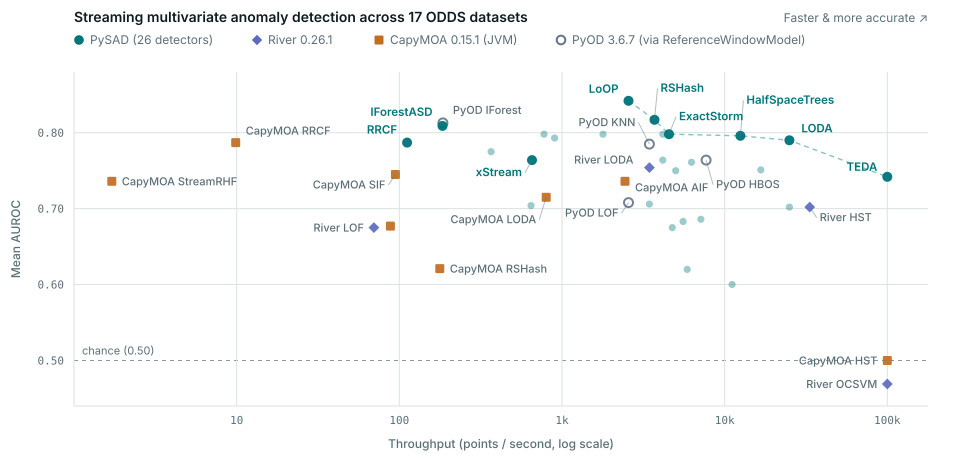

<p align="center"><a href="https://github.com/selimfirat/pysad/blob/master/README.md">English</a> · <b>简体中文</b></p>

<p align="center">
  
</p>

<h3 align="center">一遍扫描，捕获每个离群点。</h3>

<p align="center">
  面向多变量与单变量数据流的 Python 流式异常检测库。<br>
  PySAD 在每个数据点到达时立即为其打分并学习，提供经过校准的告警、漂移处理与逐点预评估——完全基于 Python、NumPy、SciPy 和 scikit-learn。
</p>

<p align="center">
  <a href="https://pypi.org/project/pysad/"></a>
  <a href="https://anaconda.org/conda-forge/pysad"></a>
  <a href="https://pypi.org/project/pysad/"></a>
  <a href="https://github.com/selimfirat/pysad/blob/master/LICENSE"></a>
  <a href="https://doi.org/10.5281/zenodo.22983312"></a>
  <br>
  <a href="https://github.com/selimfirat/pysad/actions/workflows/coverage.yml"></a>
  <a href="https://results.pre-commit.ci/latest/github/selimfirat/pysad/master"></a>
  <a href="https://coveralls.io/github/selimfirat/pysad?branch=master"></a>
  <a href="https://pysad.readthedocs.io/en/stable/"></a>
  <a href="https://github.com/selimfirat/pysad/commits/master"></a>
  <br>
  <a href="https://pysad.readthedocs.io/en/stable/benchmark.html"></a>
  <a href="https://pysad.readthedocs.io/en/stable/detectors.html"></a>
  <a href="https://pysad.readthedocs.io/en/stable/detectors.html"></a>
</p>

<p align="center">
  <a href="https://pysad.readthedocs.io/en/stable/"><b>文档</b></a> ·
  <a href="https://pysad.readthedocs.io/en/stable/getting_started.html">入门</a> ·
  <a href="https://pysad.readthedocs.io/en/stable/guides/index.html">操作指南</a> ·
  <a href="https://pysad.readthedocs.io/en/stable/benchmark.html">基准测试</a> ·
  <a href="https://pysad.readthedocs.io/en/stable/detectors.html">检测器</a> ·
  <a href="https://pysad.readthedocs.io/en/stable/api.html">API</a> ·
  <a href="https://huggingface.co/spaces/selimfirat/pysad-playground">交互式演练场</a> ·
  <a href="https://selimfirat.github.io/pysad/lab/index.html?path=nyc_taxi_alerts.ipynb">在线演示</a> ·
  <a href="https://colab.research.google.com/github/selimfirat/pysad/blob/master/examples/quickstart.ipynb">在 Colab 中试用</a>
</p>

<p align="center">
  
</p>

<p align="center"><sub>鲁棒随机切割森林（Robust Random Cut Forest）逐点为三个合成传感器的读数打分。共形校准把每个分数转换为它所超过的近期分数的比例，并在该值达到 0.995 时发出告警。</sub></p>

## 为什么选择 PySAD

批处理检测器需要拿到完整数据集才能建立模型。流式检测器在数据点到达时即时更新，无需等待完整数据集。PySAD 为多变量和单变量数据流提供统一的逐点打分与学习接口，支持概念漂移数据流。[Google Scholar](https://scholar.google.com/scholar?cites=3884618599898298487) 上有 60 多篇论文引用了它，GitHub 上有 [30 多个公开仓库](https://github.com/selimfirat/pysad/network/dependents) 在使用它。

<table>
<tr>
<td width="50%" valign="top">

#### 为数据流而生

每个检测器都通过 `fit_partial`、`score_partial` 和 `fit_score_partial` 一次学习并评分一个点。大多数检测器只保存有界窗口、概要结构（sketch）或一组树，而不是整个数据流历史。

</td>
<td width="50%" valign="top">

#### 来自已发表论文的检测器

覆盖多变量与单变量流：稳健/季节性统计方法（`MAD`、`SeasonalHybridESD`、`FluxEV`）、随机森林与概要结构（`LODA`、`HalfSpaceTrees`、`RobustRandomCutForest`、`RSHash`、`xStream`）、子序列（`DAMP`、`MatrixProfile`、`SAND`）、图流（`MIDAS`）以及 10 个漂移监测器（`ADWINMeter`、`PageHinkleyMeter`、`DriftAdaptiveDetector`）。

</td>
</tr>
<tr>
<td valign="top">

#### 统一尺度的校准告警

`ConformalProbabilityCalibrator`、基于极值理论的 `SPOTProbabilityCalibrator` 和 `GaussianTailProbabilityCalibrator` 将任意原始分数映射到 `[0, 1]`，并可配合 `ThresholdFilter` 与 `QuantileFilter` 输出二值告警。

</td>
<td valign="top">

#### 开箱即用的流式评估

`evaluate_stream`、`ArrayStreamer`、`PandasStreamer`、`PolarsStreamer` 和 `CSVStreamer` 可逐点回放流数据；`AUROCMetric`、`AUPRMetric` 和 `WindowedMetric` 逐点更新指标，覆盖 17 个带标签的 ODDS 数据集、58 条 NAB 序列与 ULB 信用卡欺诈数据集。

</td>
</tr>
<tr>
<td valign="top">

#### 可组合流水线与特征归因

使用 `|` 串联预处理、投影、日志解析（`DrainLogParser`）、检测、后处理与校准，使用 `&` 集成多个检测器，并通过 `LODA.explain_partial()` 解释触发告警的关键特征。

</td>
<td valign="top">

#### 融入现有机器学习栈

通过 `ReferenceWindowModel` 在滑动窗口上运行任意 [PyOD](https://github.com/yzhao062/pyod) 批处理检测器，通过 `PySADToRiverAdapter` / `PySADToScikitLearnAdapter` 嵌入 [River](https://github.com/online-ml/river) 或 scikit-learn 流水线，或通过 `PredictiveAnomalyDetector` 为 River 预测器打分。

</td>
</tr>
</table>

[PyOD](https://github.com/yzhao062/pyod) 等批处理离群点检测器在固定数据集上训练，要利用新数据就必须重新训练。[River](https://github.com/online-ml/river) 和 [CapyMOA](https://github.com/adaptive-machine-learning/CapyMOA) 等通用在线学习框架把异常检测当作众多模块之一（且 CapyMOA 依赖 Java）。PySAD 专注于流式异常检测：纯 NumPy/SciPy 高性能检测器、流水线组合、分数校准、漂移处理与逐点预评估一体化。

## 安装

```bash
pip install pysad
```

或通过 Conda / Mamba / Pixi 安装：

```bash
conda install -c conda-forge pysad
```

PySAD 支持 Linux、macOS 和 Windows 上的 Python 3.11 至 3.14。安装后所有检测器即可直接使用，无需额外可选依赖或 JVM。

从 `master` 分支安装最新开发版本：

```bash
pip install git+https://github.com/selimfirat/pysad.git
```

如需以可编辑模式安装并包含开发依赖，请参阅[贡献指南](https://pysad.readthedocs.io/en/latest/contributing.html)。

## 快速开始

[](https://huggingface.co/spaces/selimfirat/pysad-playground)
[](https://selimfirat.github.io/pysad/lab/index.html?path=nyc_taxi_alerts.ipynb)
[](https://colab.research.google.com/github/selimfirat/pysad/blob/master/examples/quickstart.ipynb)

逐点为数据流打分，并在运行过程中评估检测器：

```python
import numpy as np
from pysad.evaluation import AUROCMetric
from pysad.models import LODA
from pysad.utils import ArrayStreamer

# 一个包含 2,000 个点、4 个特征的数据流。每隔 50 个点有一个异常点。
rng = np.random.default_rng(42)
X = rng.normal(size=(2000, 4))
y = np.zeros(2000, dtype=int)
y[::50] = 1
X[y == 1, :2] += 3  # 在四个特征中的两个上平移异常点

model = LODA(random_state=0)
metric = AUROCMetric()

for x, label in ArrayStreamer().iter(X, y):
    score = model.fit_score_partial(x)  # 先为 x 打分，再从中学习
    metric.update(label, score)

print(f"AUROC: {metric.get():.3f}")  # 输出 AUROC: 0.960
```

### 把分数转换为告警

分数越高表示越异常，但原始分数没有固定尺度。使用 `|` 将检测器与 `ConformalProbabilityCalibrator`（或用于极值阈值的 `SPOTProbabilityCalibrator`）串联成流水线，将分数映射到 `[0, 1]` 并在接近 `1` 时告警：

```python
from pysad.transform.probability_calibration import ConformalProbabilityCalibrator

pipeline = LODA(random_state=0) | ConformalProbabilityCalibrator(window_size=500)

alerts = []
for t, x in enumerate(ArrayStreamer().iter(X)):
    calibrated = pipeline.fit_score_partial(x)
    if t >= 200 and calibrated >= 0.99:  # 跳过短暂的预热阶段
        alerts.append(t)

# 输出：20 alerts, 15 of them true anomalies
print(f"{len(alerts)} alerts, {y[alerts].sum()} of them true anomalies")
```

### 解释触发告警的特征

使用 `LODA.explain_partial()` 对导致异常分数的特征贡献进行排序：

```python
rng = np.random.default_rng(0)
X_train = rng.normal(size=(2000, 8))
detector = LODA(random_state=0).fit(X_train)

point = rng.normal(size=8)
point[[2, 5]] += 6.0  # 平移特征 2 和 5

contributions = detector.explain_partial(point)
print(
    f"Score: {detector.score_partial(point):.2f}, top features: {contributions.argsort()[::-1].tolist()[:2]}"
)
# 输出：Score: 3.46, top features: [2, 5]
```

### 处理你自己的数据流

检测器每次接收一个点的 NumPy 数组，因此任何循环都可以使用：CSV 读取器、套接字或消息队列消费者。

```python
import json

for message in consumer:  # 例如一个 Kafka 消费者
    x = np.asarray(json.loads(message.value)["features"], dtype=float)
    score = model.fit_score_partial(x)
```

`ArrayStreamer`、`PandasStreamer`、`PolarsStreamer` 和 `CSVStreamer` 可以逐行回放数组、DataFrame 与 CSV 文件，便于实验。

### 联合使用 PyOD、River 与 scikit-learn

封装任意 [PyOD](https://github.com/yzhao062/pyod) 批处理检测器并在滑动窗口上定期重新训练（`pip install pyod`）：

```python
from pyod.models.iforest import IForest
from pysad.integrations import ReferenceWindowModel

# 在最近 200 个点上训练批处理孤立森林，每 50 个点重新训练一次。
model = ReferenceWindowModel(IForest, window_size=200, sliding_size=50, initial_window_X=X[:100])
for x in ArrayStreamer().iter(X[100:]):
    score = model.fit_score_partial(x)
```

PySAD 还提供 `PySADToRiverAdapter` 与 `PredictiveAnomalyDetector` 以接入 [River](https://github.com/online-ml/river) 流水线，以及 `PySADToScikitLearnAdapter` 以接入 [scikit-learn](https://scikit-learn.org/) 流水线。更多完整流程请参阅[入门教程](https://pysad.readthedocs.io/en/stable/getting_started.html)、[操作指南](https://pysad.readthedocs.io/en/stable/guides/index.html)与[API 参考](https://pysad.readthedocs.io/en/stable/api.html)。

## 基准测试与库对比

PySAD 采用逐点预评估（使用默认参数与随机种子 0，在学习每个点之前先由 `fit_score_partial` 为其打分）测试所有检测器：

- **多变量数据流**：在 [ODDS](http://odds.cs.stonybrook.edu/) 的 17 个数据集以及 8 条包含真实漂移的数据流（`KDD http`、`INSECTS`、`SMD`）上进行评估，并附带高达 1,000 维的维度扩展测试及 100 万点内存稳定性验证。
- **单变量数据流**：在 Numenta 异常基准（NAB）全部 58 条序列上使用官方 NAB 评分器评估（`HTM` 达到 `64.2`，`RelativeEntropy` 达到 `58.9`，`KNNCAD` 复现官方 `58.0` 榜单成绩），并包含 UCR 时间序列异常档案库评估。

<p align="center">
  
</p>

<p align="center"><sub>同硬件、17 个 ODDS 数据集上的逐点预评估基准测试（默认参数，种子 0）。PySAD 检测器占据右上角的速度与精度前沿。</sub></p>

### 17 个 ODDS 数据集上的同算法横向对比

在完全一致的逐点预评估协议（[`benchmarks/compare.py`](https://github.com/selimfirat/pysad/blob/master/benchmarks/compare.py)）下对比同一算法在不同库中的表现：

| 算法 | PySAD (AUROC / ms/点) | 其他库 (AUROC / ms/点) | 对比结果 |
|---|---|---|---|
| `LODA` | **0.790** / **0.04 ms** | River `0.754` / `0.29 ms` · CapyMOA `0.715` / `1.25 ms` · StreamAD `0.649` / `0.35 ms` | AUROC 高 +0.036 至 +0.141，**速度提升 7×–31×** |
| `HalfSpaceTrees` | **0.796** / `0.08 ms` | River `0.702` / **0.03 ms** · CapyMOA `0.500` / `0.01 ms` | 相比 River **AUROC 提升 +0.094** |
| `IncrementalLOF` | **0.675** / **0.21 ms** | River `0.675` / `14.33 ms` | 精度持平，**速度提升 68×** |
| `RobustRandomCutForest` | **0.787** / **8.96 ms** | CapyMOA `0.787` / `101.37 ms` | 精度持平，**速度提升 11×**，无需 Java |
| `RSHash` | **0.817** / **0.27 ms** | CapyMOA `0.621` / `5.64 ms` | **AUROC 高 +0.196**，**速度提升 21×** |
| `OnlineOneClassSVM` | **0.702** / `0.04 ms` | River `0.469` / **0.01 ms** | **AUROC 高 +0.233** |

<sub>PySAD、River 0.26.1、CapyMOA 0.15.1 与 PyOD 3.6.7（通过 `ReferenceWindowModel`）在同一台机器上运行；StreamAD 0.3.1 需要 Python `&lt;3.12` 与 NumPy 1（因 StreamAD 的 `HSTreeDetector`、`RShashDetector` 和 `xStreamDetector` 返回的分数符号相反导致 AUROC 低于 0.5，表格仅列出方向一致的 `LODA`）。完整结果请参阅 [基准测试](https://pysad.readthedocs.io/en/stable/benchmark.html) 与 [库对比详情](https://pysad.readthedocs.io/en/stable/comparisons/index.html)（含 River、CapyMOA、StreamAD、PyOD、Alibi Detect 与 Darts）。</sub>

## 检测器

### 从哪个检测器开始

| 你的数据 | 首选 | 原因 |
|---|---|---|
| 具有日周期或周周期的单变量序列 | `SeasonalHybridESD` | 去除周期成分。窗口中较早出现的异常对它影响很小 |
| 没有明显周期的单变量序列 | `MedianAbsoluteDeviation` | 窗口中的异常对它影响很小。只使用近期的值，因此能跟随漂移 |
| 时间序列中的异常子序列 | `DAMP` 或 `SAND` | 识别异常波形子序列，而不仅是单点尖峰 |
| 多个特征，初次尝试 | `LODA` | 极快（约 40 µs/点），参数少，逐点学习并支持 `explain_partial` |
| 特征取值范围已知 | `HalfSpaceTrees` | 每个点的处理时间恒定，以上一个窗口为参照打分 |
| 特征很多 | `xStream` | 用流式哈希把数据点投影到更少的特征上 |
| 网络流量或日志 | `KitNet` 或 `DrainLogParser` + `LODA` | `KitNet` 专为实时网络入侵检测设计；`DrainLogParser` 将原始日志解析为事件 ID |
| 分布发生突变（概念漂移） | `DriftAdaptiveDetector` | 当 Page-Hinkley 监测到分数漂移时自动重置任意检测器 |
| 你已在使用的 PyOD 模型 | `ReferenceWindowModel` | 在滑动窗口上反复重新训练任意 PyOD 批处理模型 |

以上建议来自每种方法的设计，而不是基准测试排名。请按照 [检测器选择指南](https://pysad.readthedocs.io/en/stable/guides/choose_detector.html) 中的方法，在你自己的数据上比较两到三个检测器。

<details>
<summary><b>全部流式检测器</b></summary>

<br>

**多变量**

| 类 | 方法 |
|---|---|
| `xStream` | xStream (Manzoor et al., KDD 2018) |
| `LODA` | LODA 轻量级在线异常检测器 (Pevný, *Machine Learning* 2016) |
| `HalfSpaceTrees` | Half-Space Trees (Tan et al., IJCAI 2011) |
| `RobustRandomCutForest` | Robust Random Cut Forest (Guha et al., ICML 2016) |
| `RSForest` | RS-Forest 随机空间树密度估计 (Wu et al., ICDM 2014) |
| `RSHash` | RS-Hash 子空间离群点检测 (Sathe & Aggarwal, ICDM 2016) |
| `MStream` | MStream 多方面数据流计数 (Bhatia et al., WWW 2021) |
| `MemStream` | MemStream 去噪自编码器与先进先出记忆 (Bhatia et al., WWW 2022) |
| `MIDAS` | MIDAS 图数据流的边计数 (Bhatia et al., AAAI 2020) |
| `IForestASD` | 滑动窗口上的孤立森林 (Ding & Fei, IFAC 2013) |
| `OnlineIsolationForest` | 在线孤立森林 (Leveni et al., ICML 2024) |
| `PCBIsolationForest` | 带性能计数器并在检测到漂移后替换树的 PCB-iForest 孤立森林 (Heigl et al., *Electronics* 2021) |
| `KitNet` | KitNET 自编码器集成 (Mirsky et al., NDSS 2018) |
| `ExactStorm` | Exact-STORM 基于距离的离群点检测 (Angiulli & Fassetti, CIKM 2007) |
| `ApproxStorm` | 基于窗口采样的 Approx-STORM 距离离群点检测 (Angiulli & Fassetti, CIKM 2007) |
| `MCOD` | 基于微簇的距离离群点检测 (Kontaki et al., ICDE 2011) |
| `NETS` | 基于网格集合处理的距离离群点检测 (Yoon et al., PVLDB 2019) |
| `CPOD` | 基于核心点的距离离群点检测 (Tran et al., PVLDB 2020) |
| `D3` | 基于窗口链式样本核密度估计的距离离群点检测 (Subramaniam et al., VLDB 2006) |
| `ThreshLEAP` | 基于最小探测与最新优先探测的距离离群点检测 (Cao et al., ICDE 2014) |
| `IncrementalLOF` | 增量局部离群因子 (Pokrajac et al., CIDM 2007) |
| `OnlineOneClassSVM` | 在线单类支持向量机 NORMA (Kivinen et al., IEEE TSP 2004) |
| `CostSensitiveStreamModel` | 带加权铰链损失的成本敏感在线梯度下降 (Wang et al., IEEE TKDE 2014) |
| `DILOF` | 密度汇总增量局部离群因子 (Na et al., KDD 2018) |
| `MiLOF` | 带聚类摘要的高内存效率增量 LOF (Salehi et al., IEEE TKDE 2016) |
| `KELOS` | 基于窗口微簇的核密度局部离群点检测 (Qin et al., EDBT 2019) |
| `AnyOut` | 基于 ClusTree 最近簇距离的随时离群点检测 (Assent et al., DASFAA 2012) |
| `SDOstream` | 带指数衰减的稀疏数据观测器低密度流模型 (Hartl et al., ESANN 2020) |
| `ADeMS` | Frequent Directions 矩阵概要 (Huang & Kasiviswanathan, VLDB 2015) |
| `FRAHST` | 快速秩自适应行 Householder 子空间跟踪 (Teixeira & Milidiú, SAC 2010) |
| `GNGA` | 面向演化数据流的自适应生长神经气 (Bouguelia et al., *DAMI* 2018) |
| `LocalOutlierProbability` | 局部离群概率 (Kriegel et al., CIKM 2009) |
| `Inqmad` | InQMAD 量子测量密度估计 (Gallego-Mejia et al., ICDMW 2022) |
| `SmartSifter` | 基于带折扣学习的有限混合模型 (Yamanishi et al., KDD 2000) |
| `TEDA` | 典型性与离心率数据分析 (Angelov, EALS 2014) |
| `EXPoSE` | 与核均值嵌入的期望相似度 (Schneider et al., *Machine Learning* 2016) |
| `IDKS` | IDK-S 滑动窗口上的增量分布核 (Xu et al., AAAI 2026) |
| `FeedbackHST` | 带主动人机协同标签反馈的 Half-Space Trees (Tan et al., 2011; Das et al., JAIR 2024) |
| `StreamKMPlusPlus` | 基于 StreamKM++ 流式核心集聚类的最近中心距离 (Ackermann et al., ACM JEA 2012) |
| `ZeroShotEmbeddingDetector` | 基于语义锚点最大概念匹配的零样本分布外检测 (Ming et al., NeurIPS 2022) |
| `ABSAD` | 基于角度的子空间异常检测 (ABSAD) (Zhang et al., 2017) |
| `DenStream` | 密度基准流式异常检测器 (DenStream) (Cao et al., 2006) |

**单变量**

| 类 | 方法 |
|---|---|
| `SeasonalHybridESD` | Seasonal Hybrid ESD (Hochenbaum et al., 2017) |
| `SeasonalESD` | Seasonal ESD (Hochenbaum et al., 2017) |
| `HTM` | 层级时间记忆（NAB 的 Numenta 检测器），输入为带时间戳的值 (Ahmad et al., *Neurocomputing* 2017) |
| `KNNCAD` | 共形 k 近邻异常检测 (Burnaev & Ishimtsev, 2016) |
| `HoltWinters` | 基于季节性置信带与失败窗口的 Holt-Winters 预测 (Brutlag, USENIX LISA 2000) |
| `ChangeFinder` | 基于折扣学习自回归模型的离群点与变化点检测 (Takeuchi & Yamanishi, TKDE 2006) |
| `StreamingAutoregressiveDetector` | 基于 SDAR 算法的流式自回归预测残差 (Takeuchi & Yamanishi, TKDE 2006) |
| `MatrixProfile` | 基于 STAMPI 的矩阵轮廓异常子序列 (Yeh et al., ICDM 2016) |
| `DAMP` | 提前停止向后搜索的左矩阵轮廓异常子序列 (Lu et al., KDD 2022) |
| `SpectralResidual` | 滑动窗口上的谱残差显著性 (Ren et al., KDD 2019) |
| `FluxEV` | 基于极值阈值的流式波动异常检测 (Li et al., WSDM 2021) |
| `RelativeEntropy` | 基于窗口的相对熵 (Wang et al., IM 2011) |
| `SAND` | 基于 k-Shape 聚类的流式子序列异常检测 (Boniol et al., PVLDB 2021) |
| `MedianAbsoluteDeviation` | 滑动窗口上的中位数绝对偏差 (Hochenbaum et al., 2017) |
| `StandardAbsoluteDeviation` | 在线 3-sigma 规则 (Hochenbaum et al., 2017) |
| `OeSNNUAD` | 用于无监督异常检测的在线演化脉冲神经网络 (Maciąg et al., *Neural Networks* 2021) |
| `PEWMA` | 概率指数加权移动平均 (Carter & Streilein, SSP 2012) |
| `LocalPolynomialDetector` | 基于局部多项式拟合的离群点与变化点检测器 (Li et al., 2007) |

`ReferenceWindowModel` 和 `OneFitModel` 可以在数据流上运行任意 [PyOD](https://github.com/yzhao062/pyod) 检测器。[检测器目录](https://pysad.readthedocs.io/en/stable/detectors.html) 列出了每个检测器的输入、配置和内存占用，[API 参考](https://pysad.readthedocs.io/en/stable/api.html) 列出了所有参数。

</details>

## 检测器之外

| 阶段 | PySAD 提供的内容 |
|---|---|
| 预处理 | `StandardScaler`、`MinMaxScaler`、`InstanceStandardScaler`、`InstanceUnitNormScaler`、`ShingleTransformer`、`DrainLogParser`、`FunctionTransformer`、`SeasonalTrendDecomposer`、`ModifiedSTLResidualTransformer`、`OneShotSTL` |
| 投影 | `StreamhashProjector`、`GaussianRandomProjector`、`SparseRandomProjector` |
| 后处理 | 累计及窗口化的分数均值、最大值、中位数、z 分数，`DynamicThresholdPostprocessor`（Telemanom），`ThresholdFilter`，`QuantileFilter` |
| 校准 | `AnomalyLikelihoodProbabilityCalibrator`、`ConformalProbabilityCalibrator`、`GaussianTailProbabilityCalibrator`、`SPOTProbabilityCalibrator` |
| 组合与漂移 | `StreamPipeline`（`\|`）、`ModelEnsemble`（`&`，含 5 种分数集成器）、`DriftAdaptiveDetector` 以及 10 种漂移检测器（`ADWINMeter`、`PageHinkleyMeter`、`KSWINMeter`、`DDMMeter`、`EDDMMeter`、`FHDDMMeter`、`HDDMAMeter`、`HDDMWMeter`） |
| 生态集成 | `ReferenceWindowModel`、`OneFitModel`（PyOD），`PySADToRiverAdapter`、`PredictiveAnomalyDetector`（River），`PySADToScikitLearnAdapter`（scikit-learn） |
| 评估与可视化 | `evaluate_stream`、`AUROCMetric`、`AUPRMetric`、`PrecisionMetric`、`RecallMetric`、`WindowedMetric`、`RollingMetric`、`plot_stream` |
| 流式数据与统计量 | `ArrayStreamer`、`PandasStreamer`、`PolarsStreamer`、`CSVStreamer`、`Data`（17 个 ODDS 数据集、58 条 NAB 序列、ULB 信用卡欺诈），以及在线统计量（`AverageMeter`、`VarianceMeter`、`DDSketchMeter`、`OnlinePeriodicityMeter` 等） |

## 参与贡献

欢迎提交 issue 和拉取请求，我们会尽量在几天内回复。可以在 [Discussions](https://github.com/selimfirat/pysad/discussions) 中提问和分享你的项目。如果是第一次贡献，可以从 [good first issue](https://github.com/selimfirat/pysad/labels/good%20first%20issue) 中挑选一个。[贡献指南](https://pysad.readthedocs.io/en/stable/contributing.html) 列出了从首次克隆仓库到提交拉取请求的全部步骤。

PySAD 遵循 [语义化版本](https://semver.org/) 和 [主干开发](https://trunkbaseddevelopment.com/)。每项改动都通过一个短期分支和一个经过 CI 检查的拉取请求合入 `master`，并且 CI 会运行每个示例。
<p align="center">
  <a href="https://github.com/selimfirat/pysad/graphs/contributors"></a>
</p>

感谢每一位报告或修复缺陷、改进文档的人。

## 引用 PySAD

如果你在学术论文中使用了 PySAD，请引用以下论文：

```bibtex
@article{pysad,
  title={PySAD: A Streaming Anomaly Detection Framework in Python},
  author={Yilmaz, Selim F and Kozat, Suleyman S},
  journal={arXiv preprint arXiv:2009.02572},
  year={2020}
}
```

要引用软件的特定版本，请使用其 Zenodo DOI。DOI [10.5281/zenodo.22983312](https://doi.org/10.5281/zenodo.22983312) 始终指向最新版本，该页面也列出了每个版本各自的 DOI。

## 许可证

PySAD 是基于 [BSD 3-Clause 许可证](https://github.com/selimfirat/pysad/blob/master/LICENSE) 的自由软件。

---

<p align="center">
  
</p>

<p align="center">
  如果 PySAD 对你有用，点一个 Star 可以帮助更多人发现它。<br>
  如需获取新检测器和新版本的通知，请选择 <b>Watch → Custom → Releases</b>。
</p>
