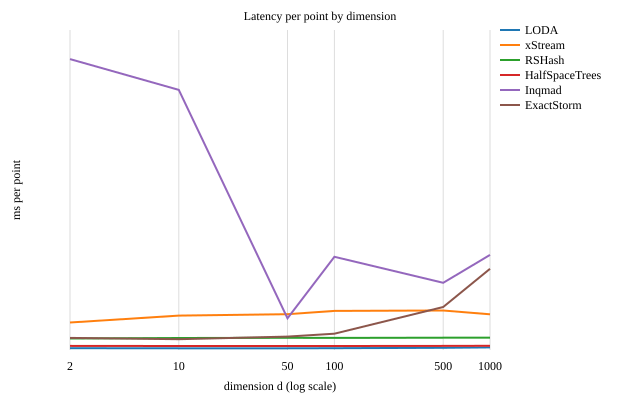

Multivariate detectors
======================

This page compares the 10 multivariate detectors on |num_datasets| ODDS datasets and on 8 real streams with drift. The best value of each column of a summary table is in bold. :doc:`methodology` explains the steps of a run and the metrics.

ODDS datasets
-------------

These tables use |num_datasets| datasets from the `ODDS <http://odds.cs.stonybrook.edu/>`_ repository. The points of each dataset are in a random order. The summary has one row for each detector, from the best mean rank to the worst. It has these columns:

Mean rank
   The rank of a detector on a dataset is its position by AUROC, where 1 is the highest AUROC. The mean rank is the average of these ranks over the |num_datasets| datasets. Detectors with the same mean rank are in the order of their mean AUROC, then their mean AUPR, then their time per point.

Mean AUROC and Mean AUPR
   The averages over the |num_datasets| datasets.

Time per point
   The median time of one ``fit_score_partial`` call, in milliseconds. All the runs used one computer, so compare these times only with each other.

Commit
   The commit of PySAD that gave the results.

.. csv-table::
   :file: ../benchmark/summary.csv
   :header-rows: 1
   :class: benchmark-table best-columns

The next table gives the AUROC on each dataset. The highest value on each dataset is in bold, and the columns are in the order of the summary. HST is :class:`~pysad.models.HalfSpaceTrees`, LoOP is :class:`~pysad.models.LocalOutlierProbability`, and RRCF is :class:`~pysad.models.RobustRandomCutForest`.

.. csv-table::
   :file: ../benchmark/auroc.csv
   :header-rows: 1
   :stub-columns: 1
   :class: benchmark-table

The next table gives the AUPR on each dataset. The AUPR of a random detector is the fraction of anomalies, which is different on each dataset. Thus, compare the values only in the same row.

.. csv-table::
   :file: ../benchmark/aupr.csv
   :header-rows: 1
   :stub-columns: 1
   :class: benchmark-table

Streams with drift
------------------

In a real stream, the normal points change over time, and an old pattern can come back. This change is called drift. Many detectors forget old points to follow drift, for example with a sliding window. These tables compare the 10 multivariate detectors on 8 real streams in their time order:

- KDD http: network connections, with attacks in 10 bursts.
- INSECTS A, I, IG and IR: optical sensor values of flying insects, with abrupt, incremental, incremental and gradual, and incremental and reoccurring drift.
- SMD 1-1, 2-1 and 3-1: server machines, with one point of 38 metrics each minute.

The tables have the same columns as the tables of the ODDS datasets. :doc:`datasets` describes the streams.

.. csv-table::
   :file: ../benchmark/drift_summary.csv
   :header-rows: 1
   :class: benchmark-table best-columns

.. csv-table::
   :file: ../benchmark/drift_auroc.csv
   :header-rows: 1
   :stub-columns: 1
   :class: benchmark-table

.. csv-table::
   :file: ../benchmark/drift_aupr.csv
   :header-rows: 1
   :stub-columns: 1
   :class: benchmark-table

Dimensionality scaling
----------------------

This sweep measures how the time per point scales with the number of features :math:`d \in \{2, 10, 50, 100, 500, 1000\}` on synthetic uniform streams of 2,000 points after a 256-point warm-up. Every detector sees the same stream at each dimension.

.. csv-table::
   :file: ../benchmark/dimensions.csv
   :header-rows: 1
   :class: benchmark-table

Memory stability
----------------

Each detector in PySAD keeps a bounded window or fixed-size summary statistics so that memory does not grow with the stream length. ``benchmarks/memory_stability.py`` verifies this over 1,000,000 continuous points after a 1,000-point warm-up by recording ``tracemalloc`` allocations every 100,000 points and checking that traced memory grows by at most 512 KiB between the second and final checkpoints (:doc:`run` shows the command and options).

.. list-table::
   :header-rows: 1
   :class: benchmark-table

   * - Detector
     - Points
     - Time (s)
     - Peak traced (KiB)
     - Growth (KiB)
   * - :class:`~pysad.models.LODA`
     - 1,000,000
     - 223.7
     - 9.3
     - 0.3
   * - :class:`~pysad.models.MedianAbsoluteDeviation`
     - 1,000,000
     - 488.2
     - 15.7
     - 0.3
   * - :class:`~pysad.models.StandardAbsoluteDeviation`
     - 1,000,000
     - 33.6
     - 1.3
     - 0.2
