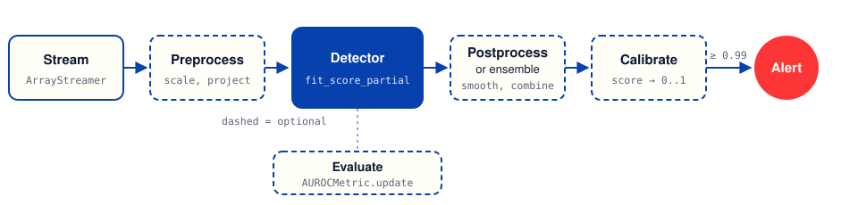
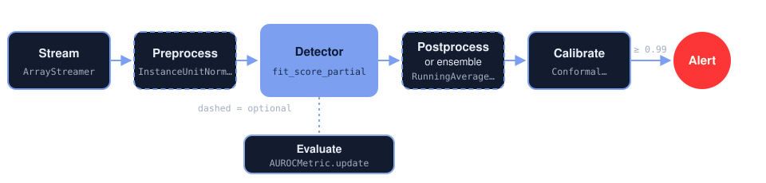
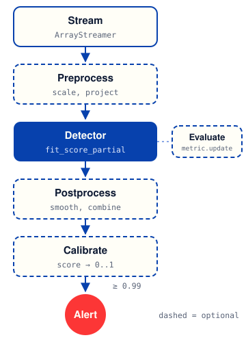
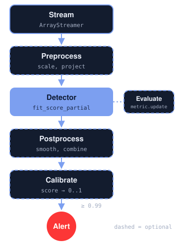

Concepts
========

This page explains the ideas behind PySAD. It shows how a streaming detector differs from a batch detector, what each component does, and why PySAD measures detectors as it does. For step-by-step instructions, see :doc:`getting_started` and the :doc:`how-to guides <guides/index>`.

Streaming anomaly detection
---------------------------

A stream is data that arrives one point at a time and does not end. A point is one record of the data, for example one sensor reading. An anomaly is a point that does not fit the pattern of the other points. Examples are a spike in a sensor reading, a fraudulent payment or a failing server.

A batch detector, such as the detectors in `PyOD <https://github.com/yzhao062/pyod>`_, trains on a complete dataset and then scores it. A stream has no complete dataset. A stream sets three constraints:

- Points arrive one at a time, and the detector must score each point before the next one arrives.
- The stream does not end, so the detector cannot keep every point in memory.
- The data drifts: normal behavior changes over time. The detector must follow the change.

A streaming detector learns from each point once and keeps a summary of the stream instead of the full stream. The summary is often a window: the most recent points or scores, up to a fixed number. The detector updates its model of normal behavior with each new point. It gives each point an anomaly score: a number that is higher for a more anomalous point.

The pipeline
------------

A PySAD pipeline is a loop over the stream. Each point goes through the same stages:

 raises an alert. A metric measures the scores while the stream runs.
   :class: only-light pipeline-wide

 raises an alert. A metric measures the scores while the stream runs.
   :class: only-dark pipeline-wide

 raises an alert. A metric measures the scores while the stream runs.
   :class: only-light pipeline-narrow

 raises an alert. A metric measures the scores while the stream runs.
   :class: only-dark pipeline-narrow

Only the stream and the detector are necessary. Each stage is an object with its own state, so you can add, remove or replace a stage without a change to the other stages.

.. list-table::
   :header-rows: 1
   :widths: 16 42 42

   * - Stage
     - Module
     - What it does
   * - Stream
     - :mod:`pysad.utils`
     - Gives the points one at a time. Your own loop over a file, a socket or a queue also works.
   * - Preprocess
     - :mod:`pysad.transform.preprocessing`, :mod:`pysad.transform.projection`
     - Scales a point, removes seasonality or reduces the number of features.
   * - Detect
     - :mod:`pysad.models`
     - Learns from the point and gives it an anomaly score.
   * - Postprocess
     - :mod:`pysad.transform.postprocessing`
     - Smooths or normalizes the scores over a window.
   * - Ensemble
     - :mod:`pysad.transform.ensemble`
     - Combines the scores of several detectors into one score.
   * - Calibrate
     - :mod:`pysad.transform.probability_calibration`
     - Converts a score into a value between 0 and 1 with the same meaning for every detector.
   * - Evaluate
     - :mod:`pysad.evaluation`
     - Measures the scores against labels (anomaly or normal), one point at a time.

.. _model-interface:

The model interface
-------------------

Every detector extends :class:`~pysad.core.BaseModel` and has two single-point methods. The API reference calls a point an instance:

``fit_partial(x)``
   Updates the model with the point ``x``, a NumPy array of shape ``(num_features,)``.

``score_partial(x)``
   Gives ``x`` an anomaly score, a Python ``float``. This method does not change the model.

``fit_score_partial(x)`` learns from ``x`` and scores it, in the order that the detector's paper uses. By default, it calls ``fit_partial`` and then ``score_partial``. :class:`~pysad.models.HalfSpaceTrees`, :class:`~pysad.models.RSHash`, :class:`~pysad.models.Inqmad`, :class:`~pysad.models.RelativeEntropy` and :class:`~pysad.models.KNNCAD` score the point before they learn from it. :class:`~pysad.models.ExactStorm` does not count the point as its own neighbor. Most loops use ``fit_score_partial``.

:class:`~pysad.core.BaseModel` builds the batch methods ``fit(X)``, ``score(X)`` and ``fit_score(X)`` from the single-point methods. They take an array of shape ``(num_instances, num_features)``, one row per point, and process its rows in order, like a stream. Batch scores are a NumPy ``float64`` array of shape ``(num_instances,)``.

Preprocessors, projectors, postprocessors, ensemblers and calibrators follow the same pattern with ``fit_partial``, ``transform_partial`` and ``fit_transform_partial``. Running statistics, for example a running mean, use ``update`` and ``get``. Most of them also have ``remove``.

Because ``score_partial`` does not change the model, you can score a point without learning from it. For example, you can stop calls to ``fit_partial`` after a training period and only call ``score_partial`` after it.

Higher means more anomalous
---------------------------

Every output in PySAD has the same direction: a higher value means a more anomalous point. This rule applies to detectors, postprocessors, ensemblers and calibrators. A threshold is the value at or above which you raise an alert. You can replace one component with another, and the same threshold logic still works.

The scale of the raw scores is different for each detector. Some detectors give a negative log density, which is high where points are rare. Some give a count and some give 0 or 1. Do not compare raw scores of two different detectors. Calibrate the scores first.

Calibration
-----------

A calibrator converts a raw score into a value between 0 and 1. PySAD has two calibrators:

:class:`~pysad.transform.probability_calibration.ConformalProbabilityCalibrator`
   Gives the fraction of recent scores that are lower than the new score. A value of 0.99 means that the new score is higher than 99% of the scores in the window. In statistics, this value is one minus the conformal p-value. It makes no assumption about the distribution of the scores.

:class:`~pysad.transform.probability_calibration.GaussianTailProbabilityCalibrator`
   Fits a Gaussian (bell-shaped) distribution to the mean and variance of recent scores. It gives the probability that a value from this distribution is lower than the new score. It assumes that the scores are approximately Gaussian.

With the conformal calibrator, a threshold such as 0.99 has the same meaning for every detector. If most recent scores come from normal points, about 1% of normal points raise an alert. A false alert is an alert for a normal point. To get fewer false alerts, increase the threshold.

Prequential evaluation
----------------------

Prequential evaluation (predict, then train) is the standard way to measure a detector on a stream. A metric is a measure of how well the scores find the anomalies. In prequential evaluation, the detector scores each point first, the metric records the score, and then the detector learns from the point. Each score comes from a model that did not see the point before, so the measurement shows how the detector does on new data.

.. code-block:: python

   for x, label in streamer.iter(X, y):
       score = model.score_partial(x)
       model.fit_partial(x)
       metric.update(label, score)

Most examples in this documentation call ``fit_score_partial`` instead. It uses the order of each detector's paper, as :ref:`the model interface <model-interface>` explains. It also matches a live system, where the detector learns from every point that it scores. The two orders give similar results for most detectors. But a detector can give a lower score to a point that it learned from a moment before. For a strict predict-then-train comparison, call ``score_partial`` before ``fit_partial`` for every detector. Fit the first point before you score, because some detectors raise an error if they score before any fit: :class:`~pysad.models.IForestASD`, :class:`~pysad.models.integrations.ReferenceWindowModel`, :class:`~pysad.models.KitNet`, :class:`~pysad.models.MedianAbsoluteDeviation` and :class:`~pysad.models.StandardAbsoluteDeviation`.

Detectors need some data before their scores are stable. This first part of the stream is the warm-up period. A metric over the full stream includes the warm-up period. To see how the results change over time, compute the metric separately on consecutive parts of the stream, as :doc:`guides/evaluate` shows.

Memory and time
---------------

Most PySAD detectors keep a summary of the stream, not the stream itself. The summary is one of these:

- A window of recent points, for example in :class:`~pysad.models.ExactStorm`, whose window slides by one point, and :class:`~pysad.models.xStream`, which replaces its window every ``window_size`` points.
- Histograms or sketches (compact counts of where points fall), for example in :class:`~pysad.models.LODA`.
- A set of trees, for example in :class:`~pysad.models.HalfSpaceTrees` and :class:`~pysad.models.RobustRandomCutForest`.
- Running statistics, for example in :class:`~pysad.models.StandardAbsoluteDeviation`.

For these detectors, the memory has a fixed upper limit, and the time to process one point does not increase as the stream gets longer. A few detectors keep data that grows with the stream. :doc:`detectors` shows the memory of each detector, so that you can choose one for a stream with no end.

Drift and forgetting
--------------------

Normal behavior changes over time. This change is drift. A detector follows drift only if it forgets old data. PySAD detectors handle old data in three ways:

.. list-table::
   :header-rows: 1
   :widths: 25 45 30

   * - How it forgets
     - Detectors
     - Effect
   * - A window of recent data
     - :class:`~pysad.models.xStream`, :class:`~pysad.models.HalfSpaceTrees`, :class:`~pysad.models.ExactStorm`, :class:`~pysad.models.IForestASD`, :class:`~pysad.models.SeasonalESD`, :class:`~pysad.models.SeasonalHybridESD`, :class:`~pysad.models.KNNCAD`
     - Data older than the window has no effect. A smaller window follows drift faster.
   * - Time decay
     - :class:`~pysad.models.RSHash`, :class:`~pysad.models.RobustRandomCutForest`
     - Old points count less and less. A larger ``decay`` (``time_decay`` for :class:`~pysad.models.RobustRandomCutForest`) follows drift faster. With the default ``time_decay=0``, :class:`~pysad.models.RobustRandomCutForest` keeps a uniform sample of the whole stream and does not forget.
   * - No forgetting
     - :class:`~pysad.models.LODA`, :class:`~pysad.models.Inqmad`, :class:`~pysad.models.MedianAbsoluteDeviation`, :class:`~pysad.models.StandardAbsoluteDeviation`, :class:`~pysad.models.RelativeEntropy`
     - Every point since the start counts equally, so the detector reacts more slowly to drift as the stream grows.

:class:`~pysad.models.KitNet` learns only during its grace periods, the first points of the stream. :class:`~pysad.models.LocalOutlierProbability` learns only from its initial points. After that, these two detectors do not follow drift.

A detector that does not forget can still follow a large, permanent change if you start a new detector after the change. :doc:`guides/production` shows how.

Reproducible results
--------------------

Some detectors use random numbers, for example to draw projections or tree splits. Each of them takes a ``random_state`` parameter. An ``int`` gives the same result on every run. ``None``, the default, draws from the global NumPy random state.

To make a complete script reproducible, pass ``random_state`` to each component, or call :func:`pysad.utils.fix_seed` once at the start. ``fix_seed`` seeds the global state that ``random_state=None`` uses.

Labels
------

A label tells whether a point is an anomaly or normal. Most detectors are unsupervised: they learn without labels. The ``y`` parameter of ``fit_partial`` exists so that every detector has the same interface. Unsupervised detectors ignore it. Metrics use labels to measure a detector. The detector never sees the labels.
