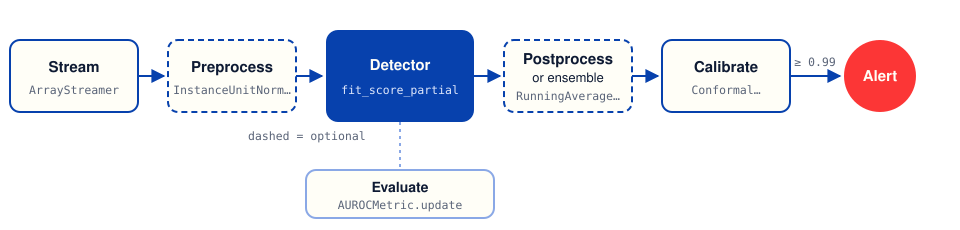

Concepts
========

This page explains the ideas behind PySAD: how a streaming detector differs from a batch detector, what every component promises, and why PySAD measures detectors the way it does. For step-by-step instructions, see :doc:`getting_started` and the :doc:`how-to guides <guides/index>`.

Streaming anomaly detection
---------------------------

An anomaly is a data point that does not fit the pattern of the other points. Examples are a spike in a sensor reading, a fraudulent payment or a failing server.

A batch detector, such as the detectors in `PyOD <https://github.com/yzhao062/pyod>`_, trains on a complete dataset and then scores it. A stream has no complete dataset. Streams set three constraints:

- Points arrive one at a time, and the detector must score each point before the next one arrives.
- The stream does not end, so the detector cannot keep every point in memory.
- The data drifts. Normal behavior changes over time, and the detector must follow the change.

A streaming detector learns from each point once and keeps a summary of the stream instead of the full stream. It updates its model of normal behavior as the stream goes on.

The pipeline
------------

A PySAD pipeline is a loop over the stream. Each point goes through the same stages:

 raises an alert. A metric measures the scores while the stream runs.

Only the stream and the detector are necessary. Each stage is an object with its own state, so you can add, remove or replace a stage without a change to the other stages.

.. list-table::
   :header-rows: 1
   :widths: 16 42 42

   * - Stage
     - Module
     - What it does
   * - Stream
     - :mod:`pysad.utils`
     - Gives the points one at a time. Your own loop over a file, a socket or a queue also works.
   * - Preprocess
     - :mod:`pysad.transform.preprocessing`, :mod:`pysad.transform.projection`
     - Scales a point, removes seasonality or reduces the number of features.
   * - Detect
     - :mod:`pysad.models`
     - Learns from the point and gives it an anomaly score.
   * - Postprocess
     - :mod:`pysad.transform.postprocessing`
     - Smooths or normalizes the scores over a window.
   * - Ensemble
     - :mod:`pysad.transform.ensemble`
     - Combines the scores of several detectors into one score.
   * - Calibrate
     - :mod:`pysad.transform.probability_calibration`
     - Converts a score into a value between 0 and 1 with the same meaning for every detector.
   * - Evaluate
     - :mod:`pysad.evaluation`
     - Measures the scores against labels, one point at a time.

The model interface
-------------------

Every detector extends :class:`~pysad.core.BaseModel` and has two single-point methods:

``fit_partial(x)``
   Updates the model with the point ``x``, a NumPy array of shape ``(num_features,)``.

``score_partial(x)``
   Gives ``x`` an anomaly score, a Python ``float``. This method does not change the model.

``fit_score_partial(x)`` calls the two methods in order. Most loops use it.

:class:`~pysad.core.BaseModel` builds the batch methods ``fit(X)``, ``score(X)`` and ``fit_score(X)`` from the single-point methods. They take an array of shape ``(num_instances, num_features)`` and process its rows in order, as if they were a stream. Batch scores are a NumPy ``float64`` array of shape ``(num_instances,)``.

Transformers, postprocessors, ensemblers and calibrators follow the same pattern with ``fit_partial``, ``transform_partial`` and ``fit_transform_partial``. Statistics use ``update``, ``remove`` and ``get``.

Because ``score_partial`` does not change the model, you can score a point without learning from it. For example, you can freeze a model after a training period and only score from then on.

Higher means more anomalous
---------------------------

Every output in PySAD has the same direction: a higher value means a more anomalous point. This rule applies to detectors, postprocessors, ensemblers and calibrators. You can replace one component with another, and your threshold logic still works.

The scale of the raw scores is different for each detector. Some detectors give a negative log density, some give a count and some give 0 or 1. Do not compare raw scores of two different detectors. Calibrate them first.

Calibration
-----------

A calibrator converts a raw score into a value between 0 and 1. PySAD has two calibrators:

:class:`~pysad.transform.probability_calibration.ConformalProbabilityCalibrator`
   Gives the fraction of recent scores that are lower than the score. A value of 0.99 means that the score is higher than 99% of the scores in the window. This is one minus the conformal p-value of the score. It makes no assumption about the distribution of the scores.

:class:`~pysad.transform.probability_calibration.GaussianTailProbabilityCalibrator`
   Fits a normal distribution to recent scores and gives the probability that a normal value is lower than the score. It needs less memory but assumes that the scores are approximately normal.

With a calibrator, a threshold such as 0.99 has the same meaning for every detector: about 1% of normal points raise an alert. To get fewer false alerts, increase the threshold.

Prequential evaluation
----------------------

Prequential evaluation (predict, then train) is the standard way to measure a detector on a stream. The detector scores each point first, the metric records the score, and then the detector learns from the point. Each score comes from a model that did not see the point before, so the measurement shows how the detector does on new data.

.. code-block:: python

   for x, label in streamer.iter(X, y):
       score = model.score_partial(x)
       model.fit_partial(x)
       metric.update(label, score)

Most examples in this documentation call ``fit_score_partial`` instead, which learns from ``x`` and then scores it. This is the order of a live system, where the detector learns from every point it scores. The two orders give similar results for most detectors, but a detector can give a lower score to a point that it learned from a moment before. Use the same order for every detector that you compare.

Detectors need some data before their scores are stable. A metric over the full stream includes this warm-up period. :class:`~pysad.evaluation.WindowedMetric` measures each window of the stream on its own, so you can see how the performance changes over time.

Memory and time
---------------

Most PySAD detectors keep a summary of the stream, not the stream itself. The summary is one of these:

- A sliding window of recent points, for example in :class:`~pysad.models.ExactStorm` and :class:`~pysad.models.xStream`.
- Histograms or sketches, for example in :class:`~pysad.models.LODA`.
- A set of trees, for example in :class:`~pysad.models.HalfSpaceTrees` and :class:`~pysad.models.RobustRandomCutForest`.
- Running statistics, for example in :class:`~pysad.models.StandardAbsoluteDeviation`.

For these detectors, the memory has a fixed upper limit, and the time to process one point does not increase as the stream gets longer. A few detectors keep data that grows with the stream. :doc:`detectors` shows the memory of each detector, so that you can choose one for an unbounded stream.

Reproducible results
--------------------

Some detectors use random numbers, for example to draw projections or tree splits. Each of them takes a ``random_state`` parameter:

- An ``int`` gives the same result on every run.
- ``None``, the default, draws from the global NumPy random state.

To make a complete script reproducible, pass ``random_state`` to each component, or call :func:`pysad.utils.fix_seed` once at the start. ``fix_seed`` seeds the global state that ``random_state=None`` uses.

Labels
------

Most detectors are unsupervised: they learn without labels. The ``y`` parameter of ``fit_partial`` exists so that every detector has the same interface. Unsupervised detectors ignore it. Metrics use labels to measure a detector, and the detector never sees them.
